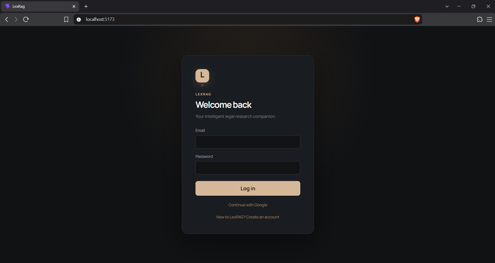
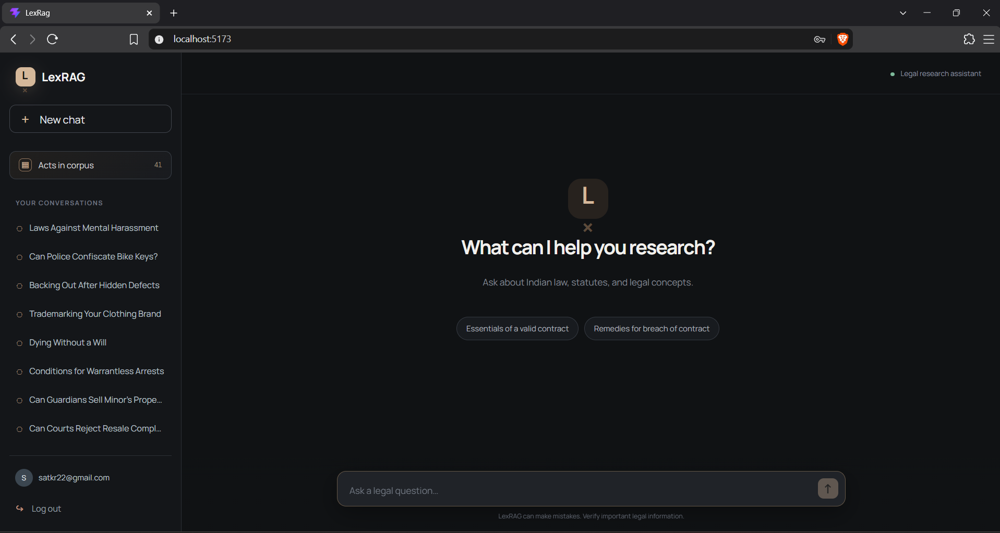

# LexRAG

LexRAG is an AI legal research assistant for Indian legislation. A user asks a legal question in the web app; the backend routes the query, retrieves relevant statutory sections, and uses an agent to reason over the retrieved context and respond with a streamed answer.

LexRAG is built for legal research assistance, not as a replacement for a lawyer or an authoritative source of current law.

## UI Demo

Below is a demonstration of the LexRag interface in action.

<h3>Work Flow<h3>

https://github.com/user-attachments/assets/d77e78dc-6323-4e43-b6c2-a3af88045380

<h3>Login<h3>

https://github.com/user-attachments/assets/686bfbf3-4762-422e-97d6-6ce7ae3986c5

### Interface Screenshots

## Work Flow

1. The user signs in and submits a question from the React web app.
2. The FastAPI backend authenticates the request and starts an agent run.
3. The router decides whether the question needs legal retrieval and enriches it for search.
4. Hybrid retrieval searches the statutory corpus with dense embeddings and BM25, fused with Reciprocal Rank Fusion.
5. The agent can use the initial context or call additional legal-search tools when more evidence is needed.
6. The answer and execution events are streamed back to the frontend.
7. Users, sessions, and messages are persisted in PostgreSQL.

See the detailed system design in [docs/architecture.md](docs/architecture.md).

## Architecture

~~~mermaid
flowchart LR
    U[User] --> FE[React + Vite frontend]
    FE -->|JWT + query| API[FastAPI API]
    API --> AGENT[LangGraph legal agent]
    AGENT --> ROUTER[Query router]
    ROUTER -->|semantic query + BM25 terms + categories| RETRIEVER[Hybrid retriever]
    RETRIEVER -->|dense search| QD[(Qdrant legal_docs)]
    RETRIEVER -->|BM25 search| QD
    QD --> RRF[Reciprocal Rank Fusion]
    RRF --> AGENT
    AGENT -->|optional tool calls| RETRIEVER
    AGENT -->|streamed events| API
    API --> FE
    API --> PG[(PostgreSQL)]

    SOURCES[Statutory HTML sources] --> INGEST[Ingestion pipeline]
    INGEST --> PARSE[Parse, merge and chunk]
    PARSE --> EMBED[Dense + sparse embeddings]
    EMBED --> QD
    PARSE --> PG
~~~

The architecture diagram is intentionally high level. Component responsibilities, data stores, runtime paths, and ingestion/evaluation flows are documented in [docs/architecture.md](docs/architecture.md).

## Installation and setup

### Prerequisites

- Docker Desktop (or Docker Engine with the Compose plugin).
- A Supabase project for authentication.
- API credentials for the LLM providers used by the backend.
- Enough disk space for PostgreSQL, Qdrant, and embedding-model caches.

CUDA is optional. Set `QDRANT_INFERENCE_CUDA=false` when running embedding inference on the CPU.

### Clone the repository

~~~bash
git clone <repository-url>
cd LexRag
~~~

### Configure environment variables

Create a `.env` file in the repository root. The database URLs must use the Docker Compose service name `postgres` when the application runs in containers:

~~~dotenv
GEMINI_API_KEY=...
DASHSCOPE_API_KEY=...
SUPABASE_URL=...
SUPABASE_PUBLISHABLE_KEY=...

POSTGRES_USER=...
POSTGRES_PASSWORD=...
POSTGRES_DB_MAIN=...
POSTGRES_DB_CORPUS=...
POSTGRES_DB_USERS=...

DATABASE_URL_MAIN=postgresql+psycopg://<user>:<password>@postgres:5432/<main-database>
DATABASE_URL_CORPUS=postgresql+psycopg://<user>:<password>@postgres:5432/<corpus-database>
DATABASE_URL_USERS=postgresql+psycopg://<user>:<password>@postgres:5432/<users-database>

QDRANT_URL=http://qdrant:6333
QDRANT_INFERENCE_CUDA=false

# Match these to the local user that owns the checked-out files.
UID=1000
GID=1000
~~~

Replace the placeholder database names and credentials with matching values. If a password contains characters such as `@`, `:` or `/`, URL-encode it in each `DATABASE_URL_*` value. Keep `.env` out of version control.

### Install and start the services

~~~bash
docker compose up --build
~~~

The first build installs the backend and frontend dependencies. On startup, the backend waits for PostgreSQL and runs both Alembic migration sets automatically.

Services:

- Frontend: http://localhost:5173
- Backend API: http://localhost:9000
- Health check: http://localhost:9000/health
- OpenAPI docs: http://localhost:9000/docs
- Chat endpoint: POST http://localhost:9000/agent/chat

The chat endpoint requires a valid Supabase bearer token and accepts a query plus thread_id.

To stop the services, press `Ctrl+C`. To start them again without rebuilding, run:

~~~bash
docker compose up
~~~

To remove the containers while keeping the local PostgreSQL and Qdrant data, run:

~~~bash
docker compose down
~~~

## Repository structure

~~~text
LexRag/
├── backend/
│   ├── app/
│   │   ├── agent/              Agent runtime, graph, prompts and tools
│   │   ├── api/                FastAPI routes
│   │   ├── common/             Settings, auth and shared utilities
│   │   ├── db/                 PostgreSQL models and sessions
│   │   └── rag/
│   │       ├── data_ingestion/ Source scraping, parsing, chunking and persistence
│   │       ├── evaluation/     Retrieval benchmark datasets and metrics
│   │       ├── retrieval/      Query routing and hybrid search
│   │       └── vector_embeddings/
│   │                            Embedding and Qdrant indexing jobs
│   ├── alembic_*/               Database migrations
│   ├── Dockerfile
│   └── requirements.txt
├── frontend/
│   ├── src/                     React application
│   ├── public/                  Static assets
│   └── package.json
├── data/                        Local PostgreSQL and Qdrant storage
├── docs/
│   └── architecture.md         Detailed architecture reference
├── docker-compose.yaml
└── README.md
~~~

## RAG retrieval evaluation

The checked-in benchmark evaluates the retrieval layer only. It does not evaluate the LangGraph agent, tool selection, generated answers, streaming behavior, authentication, latency, or end-to-end legal correctness.

The benchmark contains 163 questions over the BNS 2023, BNSS 2023, and BSA 2023 corpus:

- 113 questions have one referenced section.
- 50 questions have multiple referenced sections and test multi-hop context retrieval.
- Retrieval returns up to five sections per question.
- The dataset stores reference section IDs and reference context, then records the retrieved section IDs and text.

### Current retrieval results

Source: [evaluation_results.json](backend/app/rag/evaluation/ragas/result/evaluation_results.json).

| Metric | Score | What it measures |
|---|---:|---|
| ID-based context recall | 89.88% | How many referenced section IDs were recovered |
| ID-based context precision | 82.45% | Ranked precision of retrieved section IDs |
| Hit@5 | 96.32% | Whether at least one referenced section appeared in the top five |
| MRR | 90.85% | How early the first referenced section appeared |
| LLM context recall | 82.54% | LLM-judged coverage of reference context by retrieved text |

These numbers describe retrieval quality, not agent quality. A high Hit@5 score means the retriever often finds at least one relevant section; it does not prove that the agent selected the right tools, used all required sections, or generated a correct answer.

### Evaluation files

- Metrics summary: [evaluation_results.json](backend/app/rag/evaluation/ragas/result/evaluation_results.json)
- Per-question results: [evaluation_rows_comprehensive.csv](backend/app/rag/evaluation/ragas/result/evaluation_rows_comprehensive.csv)
- Evaluation log: [evaluation_live_log.json](backend/app/rag/evaluation/ragas/result/evaluation_live_log.json)
- Dataset with retrieved contexts: [ragas_evaluation_dataset.json](backend/app/rag/evaluation/ragas/data/ragas_evaluation_dataset.json)
- Evaluation implementation: [evaluate_comprehensive.py](backend/app/rag/evaluation/ragas/evaluate_comprehensive.py)

## Data ingestion

The corpus ingestion pipeline performs the following operations:

1. Scrape statutory HTML pages.
2. Parse and normalize the pages.
3. Merge section fragments.
4. Persist section metadata in PostgreSQL.
5. Chunk content for retrieval.
6. Generate dense and sparse embeddings.
7. Index vectors and payloads in Qdrant.

The main entry point is [data_ingestion_pipeline.py](backend/app/rag/data_ingestion_pipeline.py).

## Development

~~~bash
# Backend dependencies
pip install -r backend/requirements.txt

# Frontend checks
cd frontend
npm run lint
npm run build
~~~

## Limitations

- The legal corpus can become outdated; re-index when source legislation changes.
- The current benchmark is retrieval-only.
- Answer faithfulness, citation correctness, agent trajectories, tool-call accuracy, latency, and cost need separate evaluation.
- Retrieved content should be checked against the current law before it is used for a legal decision.

## Disclaimer

LexRAG is a research project and does not provide legal advice. Verify applicable law and consult a qualified legal professional.
